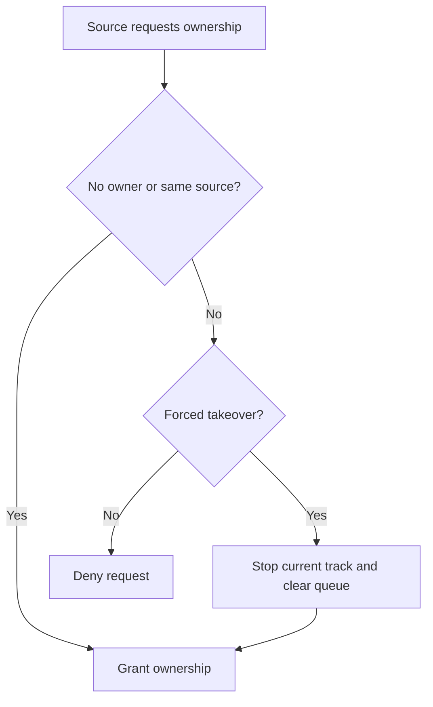
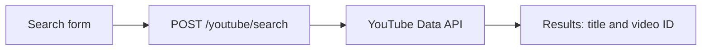
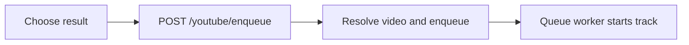
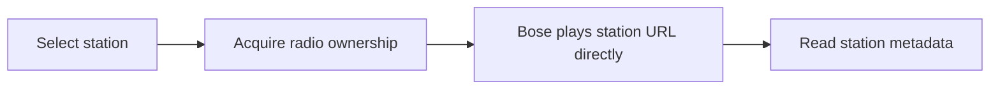
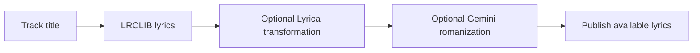
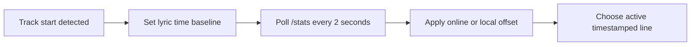
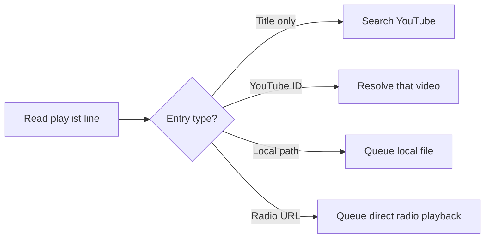

# Musicify Codebase Explanation

This document describes the application as implemented in the repository. Code links below are relative to this file and point to the relevant implementation lines.

## 1. What the application does

Musicify is a Flask web application with three music sources—YouTube, local files, and internet radio—plus common player controls. Online and local tracks are read by a background queue worker, converted to an Ogg audio stream by FFmpeg, and sent to the configured Icecast mount. A Bose SoundTouch speaker can then play that stream. Radio is different: its station URL is played directly by the speaker, rather than being passed through the FFmpeg queue.

The central pieces are:

- [app.py](app.py#L19): constructs the Flask app and the shared runtime objects.
- [PlaybackController](core/playback_controller.py#L10): arbitrates which source currently controls the queue.
- [QueuePlayer](core/stream_manager.py#L18): stores upcoming tracks and runs the playback worker.
- [FFmpegService](services/ffmpeg_service.py#L14): starts/stops the FFmpeg process that streams a track to Icecast.
- [core/settings.py](core/settings.py#L18): loads environment configuration and persistent user settings.
- The `apps/` route modules expose the local, YouTube, and radio interfaces; [core/stats.py](core/stats.py#L53) exposes shared status and controls.

## 2. Playback ownership and the controller

### The owner property

Ownership is stored on the `PlaybackController` instance as its private `_owner` field and exposed through the read-only `owner` property in [core/playback_controller.py](core/playback_controller.py#L10). The owner is a source name such as `local`, `youtube`, `radio`, or `playlist`; it is not the name of a user or a process.

`acquire(source, force=False)` behaves as follows:

1. If no source owns playback, the requester becomes the owner.
2. The current owner may acquire again without changing state.
3. If another source owns playback, the request is denied unless `force=True`.
4. A forced takeover resets the current player (stops the current track and clears the queue) before assigning the new owner.
5. Radio ownership suppresses autoplay; acquiring any other source resumes it.

`release(source)` succeeds only for the current owner. It resets the player and clears ownership. The `enqueue` and `enqueue_many` methods require the caller's source name to match the owner; they return `False` when it does not. Queue edits (`remove_from_queue`, moving tracks), `skip`, and `stop` are intentionally allowed without changing ownership. See [acquire/release and enqueue operations](core/playback_controller.py#L21) and [queue controls/reset](core/playback_controller.py#L84).

### How routes use ownership

- The local and YouTube pages acquire their source when the user requests it. Their enqueue routes can acquire automatically if there is no owner, but do not take playback away from a different owner.
- Radio playback deliberately calls `acquire("radio", force=True)`. It takes over the speaker and suppresses autoplay; see [_play_station](apps/radio/routes.py#L372).
- Loading a playlist claims the special `playlist` owner with a forced takeover. Each parsed track is enqueued under that identity.
- The shared `owner` field is returned by `/stats` and is also used to distinguish radio/local playback for status and lyrics.

**Important distinction:** ownership lives on `current_app.playback`, not on `QueuePlayer`. The autoplay code tries `getattr(self, "owner", None)` on the player, then falls back to classifying a track as local or online from its URL. The controller's owner is therefore authoritative for routes/status, while autoplay's source classification is a separate URL-based heuristic; see [_trigger_autoplay](core/stream_manager.py#L172).

### Ownership decision



Enqueue requests then succeed only when the caller matches the current owner. See [PlaybackController.acquire](core/playback_controller.py#L21) and [enqueue](core/playback_controller.py#L70).

## 3. Queue and playback implementation

`QueuePlayer` keeps a FIFO Python list (`queue`), the current song, and the active process. A lock protects queue operations. `enqueue` appends one song, `enqueue_many` appends a batch, and `_get_next_song` removes the first item. The daemon worker started by `start()` checks for a next item about once per second; see [queue methods](core/stream_manager.py#L51) and [_worker](core/stream_manager.py#L328).

For regular online/local tracks, the worker records eligible YouTube history, may asynchronously prefill autoplay recommendations when the queue becomes empty, then starts FFmpeg and waits for the process. `skip()` terminates the current process but does not itself clear the rest of the queue. The controller reset used for release/takeover clears both queue and current-song state.

The typical queued song is a dictionary containing:

| Field | Purpose |
|---|---|
| `title` | Display title and, for online songs, lyric-search text. |
| `url` | Local file path or resolved direct audio URL used as FFmpeg input. |
| `thumbnail` | Artwork URL or a static fallback image. |
| `videoId` | YouTube video ID, used for history and YouTube metadata. |
| `source_url` | Original YouTube watch URL; FFmpeg can use `yt-dlp` to resolve it. |
| `stream_headers` | Optional headers returned by `yt-dlp` for the audio URL. |
| `record_history` | Whether the YouTube song should be written to history. |
| `station` | Radio station metadata for a queued radio item. |

[FFmpegService.start_stream](services/ffmpeg_service.py#L15) accepts either a local path or URL. For a YouTube `source_url`, it launches `yt-dlp` as a subprocess and pipes its audio into FFmpeg. FFmpeg encodes Ogg/Vorbis and publishes to the Icecast mount. The current mount target is a constant in that service, while the speaker's listening URL is configured with `STREAM_URL`.

### YouTube search and queue flow

The normal search path returns metadata (not audio). Selecting a result queues it; the worker later streams the audio.





See the browser flow in [yt.html](templates/yt.html#L49), search route in [apps/yt/routes.py](apps/yt/routes.py#L625), and queue construction in [YTService.enqueue_youtube_result](services/yt_service.py#L53).

### Audio stream flow

At enqueue time, the YouTube service resolves stream information and stores the original `source_url`. When playback starts, FFmpeg launches `yt-dlp` using that source URL, then encodes its output for Icecast.


The worker starts FFmpeg in [QueuePlayer._worker](core/stream_manager.py#L328); see [FFmpegService.start_stream](services/ffmpeg_service.py#L15) and [the configured stream URL](core/settings.py#L231).

### Radio in the queue

Radio bypasses the normal FFmpeg source path. A queued item whose title has the form `Radio:(station name)` is detected by the worker and passed to the configured radio handler instead. The handler calls the station playback routine, which asks the SoundTouch worker to play the station URL directly. See the [radio marker branch](core/stream_manager.py#L371) and [radio handler setup](apps/radio/routes.py#L417).



This flow uses [_play_station](apps/radio/routes.py#L372); it does not go through the queue's FFmpeg-to-Icecast path.

## 4. Listening on Bluetooth, network devices, or the local computer

The web pages are primarily a **remote control**. They do not contain a browser audio player: queued online and local tracks are published to Icecast, and the configured speaker/client plays that stream.

- **Bluetooth from the server (idea only; not implemented):** Musicify does not pair the server with Bluetooth speakers and does not route its queue to a Bluetooth audio sink. One possible Linux approach is to pair/connect the server to the speaker using `bluetoothctl`, configure PipeWire/PulseAudio/ALSA to expose the speaker as an audio output, and run a local audio client such as `mpv` against the Musicify Icecast stream with that output selected. Another, more integrated approach would be to add a playback backend that sends queued tracks to the configured Bluetooth audio sink instead of publishing them through FFmpeg/Icecast. These are implementation ideas only; the commands below are not Musicify features, and the exact `bluetoothctl` pairing prompts vary by system:

  ```text
  bluetoothctl
  power on
  scan on
  pair <DEVICE_MAC>
  connect <DEVICE_MAC>
  ```

  A system may also require selecting/trusting the device and configuring its audio profile/output in the desktop audio stack. As a manual experiment, after making the Bluetooth speaker the server's default audio output, a user could try `mpv <STREAM_URL>` (with `mpv` installed) to listen to the Icecast stream through it. Exact audio-output selection depends on the system's PipeWire/PulseAudio/ALSA setup. Pairing alone does not make the current Musicify queue use Bluetooth. There is a Bose source-selection command named `bluetooth` in [core/bose_routes.py](core/bose_routes.py#L28); that only asks the configured Bose speaker to select its Bluetooth input—it is not server-side Bluetooth pairing or queue streaming.
- **Cast/network playback:** The app can tell the configured Bose speaker to play `STREAM_URL` using `GET /ctrl/listen` (the reconnect button calls the same route). This uses the Bose UPnP/AVTransport interface. For another network player, open the `STREAM_URL` value in that device's Icecast/HTTP stream player, provided the device supports the stream format and can reach the Musicify host on the LAN. Musicify does not implement a general Chromecast/AirPlay device picker or a generic cast endpoint.
- **Play on the server computer:** Browse `/local/` to queue files beneath the server's `ROOT_DIR`; those files still go through the Icecast route, rather than playing from the browser's speakers. To play a file directly through the computer's own speakers, open it with that computer's media player. To listen to the Musicify queue locally, use a compatible Icecast client on that computer and open `STREAM_URL`; if desired, the computer's operating system can route that client's output to its built-in speakers or a paired Bluetooth device.

The Icecast URL must use a host/IP reachable from the listening device; `127.0.0.1` only refers to the device making the request. The setup helper normally writes a LAN address into `STREAM_URL`. Relevant implementations: [Bose command route](core/bose_routes.py#L28), [UPnP stream playback](core/bose_worker.py#L136), and [configured stream URL](core/settings.py#L231).

## 5. Lyrics: lookup, timing, and display

Lyrics are managed by [LyricsService](services/lyrics_service.py#L145), created once in `create_app()`. The browser polls `/stats`; that handler compares the current `(owner, title)` with the previous lyrics context and calls `reset()` when a new track begins. Local tracks are intentionally limited to the LRCLIB stage, whereas online tracks use the configured maximum effort; radio suppresses lyrics. See [stats and lyrics context handling](core/stats.py#L53).

### Lookup stages

The lyrics stages, in increasing order, are `LRCLIB`, `LYRICA`, and `GEMINI`. The selected `lyrics_effort` is a maximum stage:

1. **LRCLIB:** Musicify cleans video-label text from the title, attempts artist/track resolution using Last.fm when `LASTFM_KEY` is configured, then falls back to splitting `Artist - Track` or using the remaining title as the track. It queries LRCLIB for synced and/or plain lyrics. This stage does not require an API key.
2. **Lyrica:** When the maximum stage allows it, Musicify calls the configured Lyrica lyrics service with translation and romanization requested. Its output is aligned to LRCLIB timestamps where possible. No Lyrica API key is configured by this application.
3. **Gemini:** At the `GEMINI` stage, Musicify only requests Gemini romanization when it has lyrics containing non-Latin script. It sends a prompt that requests transliteration—not translation—and preserves line breaks. This stage requires `GEMINI_API_KEY`.

The fetch runs in a daemon thread so a slow provider does not block the status request. A generation counter prevents a late response for the previous song from replacing the current song's lyrics. The lookup pipeline is in [_load_lyrics](services/lyrics_service.py#L208); Gemini romanization is in [romanize_lyrics](services/lyrics_service.py#L91).

### Lyrics lookup flow

Each later stage is optional and runs only when allowed by the selected effort; successful later results can replace the earlier display.



Local playback is limited to LRCLIB by the `/stats` handler. Online lookup can use the configured maximum stage.

### Timestamps and offsets

`parse_synced_lyrics()` parses LRC timestamps such as `[01:23.45]` into seconds and lyric text. If one lyric line contains multiple timestamps, it creates one timed entry for each. `align_lyrics()` uses those LRCLIB timestamps for translated/romanized text, distributing timestamps across transformed lines; if no timestamps exist, lines are returned as untimed. See [parsing and alignment](services/lyrics_service.py#L30).

The timing baseline is set by `LyricsService.reset()` when `/stats` first detects a changed owner/title context, rather than by a precise callback from the audio device. The browser polls `/stats` every 2 seconds. For a given poll the service calculates:

```text
elapsed_for_lyrics = current_time - song_start_time + offset_ms / 1000
```

It then selects the last lyric whose timestamp is less than or equal to that value. A negative offset delays lyrics: for example, `-2000` means the line stamped at 10 seconds appears when elapsed playback time reaches about 12 seconds. A positive offset advances them. If the player reports not playing, `/stats` moves the baseline forward by 2 seconds per poll, approximately pausing the lyric clock; this is a polling-based adjustment, not audio-position synchronization. Online and local playback have independent millisecond offsets stored in `userconfig.json`.

Because the browser polls every two seconds and the baseline is set when the status poll notices a track change, lyric timing is approximate and can have polling/startup drift. Adjust the relevant offset in 100 ms steps to compensate for a consistent lead/lag; a negative offset makes lines appear later, while a positive offset makes them appear earlier. Untimed plain lyrics have no timestamp for selecting a current line, even though their text may be returned in the lyric list.



The service's exact timestamp selection and offset calculation are in [get_lyrics_state](services/lyrics_service.py#L321); `/stats` detects track changes and adjusts the baseline when playback is paused in [stats](core/stats.py#L53), and the poll interval is defined in [common.js](static/common.js#L1205).

## 6. Routes

Blueprint prefixes are registered in [create_app()](app.py#L47). Routes with no explicit `methods` argument use Flask's default `GET`. Request bodies described as JSON should be sent with `Content-Type: application/json`, except `/youtube/search` and `/youtube/auto_pick`, which read form fields.

### Global, Bose, and shared player routes

| Method | Route | Required inputs | What it does |
|---|---|---|---|
| GET | `/` | — | Redirects to the YouTube player page. [index](app.py#L43) |
| GET | `/ctrl/<cmd>` | `cmd`: `vol_up`, `vol_down`, `bose_power`, `mute`, `bluetooth`, `aux`, or `listen` | Sends a Bose control command. `bluetooth` selects Bose Bluetooth input; `listen` directs it to the configured stream by UPnP. Unknown commands return an `unknown command` status. [ctrl](core/bose_routes.py#L28) |
| GET | `/set_vol/<level>` | `level` path integer, 0–100 expected by the Bose worker | Sets speaker volume. [set_volume](core/bose_routes.py#L65) |
| GET | `/get_status` | — | Returns volume, power state, source, track, and artist. [get_status](core/bose_routes.py#L71) |
| GET | `/is_on` | — | Returns speaker power status. [check_power](core/bose_routes.py#L86) |
| GET | `/stats` | — | Returns CPU, volume, owner, queue, current song, radio/player state, autoplay/incognito settings, and lyric state. [stats](core/stats.py#L53) |
| POST | `/toggle_lyrics` | — | Toggles lyrics at runtime and starts a lookup for the current non-radio song when enabling. Does not persist this enabled/disabled flag. [toggle_lyrics](core/stats.py#L117) |
| POST | `/lyrics_offset` | JSON: integer `offset_ms`; optional `source` (`online` or `local`, default `online`) | Persists and applies one source's lyric offset. [set_lyrics_offset](core/stats.py#L132) |
| POST | `/lyrics_effort` | JSON: `lyrics_effort` equal to `LRCLIB`, `LYRICA`, or `GEMINI` | Persists and applies the maximum lyrics lookup stage. [set_lyrics_effort](core/stats.py#L158) |
| POST | `/toggle_autoplay` | — | Toggles autoplay. [toggle_autoplay](core/stats.py#L178) |
| POST | `/toggle_incogni` | — | Toggles the in-memory incognito flag used by autoplay/recommendations and by the web UI to choose its queue endpoint. It does not persist the flag. [toggle_incogni](core/stats.py#L189) |
| POST | `/shutdown` | — | Stops player/server and powers off Bose unless radio currently owns playback. [shutdown](core/stats.py#L199) |
| GET | `/playlists` | — | Returns `.txt` playlist names from `PLAYLIST_DIR`. [playlists](core/stats.py#L222) |
| POST | `/add_to_playlist` | JSON: `playlist` name and `song` object | Appends a title, title plus source, or special radio URL to a playlist file. A regular song object can provide `title` and `videoId` or `url`; radio items need a `Radio:(...)` title and HTTP(S) `url`. [add_to_playlist](core/stats.py#L238) |
| POST | `/remove_from_queue/<index>` | Queue index path integer | Removes that queued item and returns its title. [remove_from_queue](core/stats.py#L334) |
| POST | `/play_next/<index>` | Queue index path integer | Moves the chosen queued item to the front. [play_next](core/stats.py#L352) |
| POST | `/reorder_queue/<source_index>/<target_index>` | Two queue index path integers | Moves one queue item to another valid queue position. [reorder_queue](core/stats.py#L359) |
| POST | `/power` | — | Uses the Bose power control; when called internally with the shutdown-only flag it powers the speaker off. [power](core/stats.py#L366) |
| GET | `/poweroff` | — | Disables autoplay, releases the current owner or stops the idle player, clears radio state, and powers off Bose. [poweroff](core/stats.py#L375) |
| POST | `/stop` | — | Disables autoplay, stops playback, and clears the queue. [stop](core/stats.py#L391) |
| POST | `/skip` | — | Skips the current track without clearing upcoming tracks. [skip](core/stats.py#L398) |
| GET | `/playlist/<name>` | Playlist name path; corresponding `<name>.txt` must exist | Reads and shuffles playlist entries, resolves/enqueues supported local/YouTube entries, and can enqueue one radio station after regular tracks. [playlist](core/stats.py#L404) |

Most queue controls do not accept a source/owner argument. They operate through the shared controller; invalid queue positions return an error rather than changing owner.

### Local-file routes (`/local`)

| Method | Route | Required inputs | What it does |
|---|---|---|---|
| GET | `/local/`, `/local/browse/`, `/local/browse/<subpath>` | Optional relative `subpath` | Browses `ROOT_DIR`, lists supported media files and directories, and renders the local player. Paths outside the root are rejected. [browse](apps/local/routes.py#L41) |
| POST | `/local/acquire` | Optional JSON `force` boolean | Requests local playback ownership; reports whether granted and the current owner. [acquire](apps/local/routes.py#L67) |
| POST | `/local/enqueue_random` and `/local/enque_random` | Optional JSON `path`, query `path`, or browser referrer used to infer the folder | Chooses and queues one random local media file. The second spelling is a backward-compatible alias. [enqueue_random](apps/local/routes.py#L125) |
| POST | `/local/enqueue` | JSON with `rel_path` and `title` | Resolves a relative path under `ROOT_DIR` and queues that local file. [enqueue](apps/local/routes.py#L157) |
| POST | `/local/play_folder` | JSON optional relative `path` (empty means root) | Recursively lists supported files under the folder and queues them alphabetically. [play_folder](apps/local/routes.py#L186) |
| GET | `/local/search?q=<text>` | Query parameter `q` | Searches local directory/file names. Empty query returns an empty list. [search_local_items](apps/local/routes.py#L255) |

### YouTube and history routes (`/youtube`)

| Method | Route | Required inputs | What it does |
|---|---|---|---|
| POST | `/youtube/ai_recommendations` | JSON non-empty `user_prompt` | Requests exactly three Gemini recommendations based on the playback history and queues them asynchronously. Requires `GEMINI_API_KEY` and YouTube playback resolution. [ai_recommendations](apps/yt/routes.py#L393) |
| GET | `/youtube/` | — | Renders the online player. [index](apps/yt/routes.py#L435) |
| GET | `/youtube/hist` and `/youtube/hist/` | Optional query `table` | Renders the history editor for the requested or active SQLite table. [history_manager](apps/yt/routes.py#L442) |
| POST | `/youtube/hist/api/update` | JSON `table`, `id`, `song_name`, `song_id`; optional `number_of_listens`, `datetime_str` | Updates a history row. `song_id` must normalize to a YouTube video ID. [hist_update_record](apps/yt/routes.py#L473) |
| POST | `/youtube/hist/api/delete` | JSON `table` and row `id` | Deletes a history row. [hist_delete_record](apps/yt/routes.py#L507) |
| POST | `/youtube/hist/api/add` | JSON `table`, `song_name`, `song_id`; optional `number_of_listens`, `datetime_str` | Adds a history row or accumulates listens into the row with the same video ID. [hist_add_record](apps/yt/routes.py#L527) |
| POST | `/youtube/hist/api/set_active` | JSON `table_name` | Selects the active history table, creating it if needed. [hist_set_active](apps/yt/routes.py#L557) |
| POST | `/youtube/hist/api/create_table` | JSON `table_name` | Creates a sanitized history table. [hist_create_table](apps/yt/routes.py#L573) |
| POST | `/youtube/hist/api/delete_table` | JSON `table_name` (cannot be `history`) | Deletes a custom history table; the default table is protected. [hist_delete_table](apps/yt/routes.py#L589) |
| GET | `/youtube/<filename>` | One path-segment table name | Switches the active history table and redirects to the online player. It is not a static-file download route. [switch_history_table](apps/yt/routes.py#L608) |
| POST | `/youtube/search` | Form field `query` | Searches YouTube Data API and returns video title, thumbnail, ID, and channel. Empty query returns an empty list. [search](apps/yt/routes.py#L625) |
| POST | `/youtube/auto_pick` | Form field `query` | Finds a suitable YouTube match and queues it; acquires YouTube ownership only if the player is currently unowned. [auto_pick](apps/yt/routes.py#L647) |
| POST | `/youtube/acquire` | Optional JSON `force` boolean | Requests YouTube ownership and reports the grant/current owner. [acquire](apps/yt/routes.py#L672) |
| POST | `/youtube/enqueue` | JSON song object with `title`, `videoId`, and usually `thumbnail` | Resolves the video to an audio stream and queues it with `record_history=True`. The web UI switches to `/youtube/enqueue_incognito` when incognito is enabled. [enqueue](apps/yt/routes.py#L722) |
| POST | `/youtube/enqueue_incognito` | Same JSON song object as `/enqueue` | Resolves/queues the video but explicitly disables history recording for that item. [enqueue_without_history](apps/yt/routes.py#L727) |

The history endpoints validate table names and video IDs before passing them to the database layer. The active database table can also be chosen with `HISTORY_TABLE` at startup.

### Radio routes (`/radio`)

| Method | Route | Required inputs | What it does |
|---|---|---|---|
| GET | `/radio/` | — | Renders the radio page with popular stations, saved presets, favorites, and genres. [index](apps/radio/routes.py#L430) |
| GET | `/radio/search?q=<text>&tags=<csv>` | Optional `q`; optional comma-separated supported `tags` | Searches Radio Browser. If both are empty, returns an empty list; invalid/duplicate genres return 400. [search](apps/radio/routes.py#L453) |
| POST | `/radio/play` | JSON `station` object with a valid HTTP(S) station URL | Force-acquires radio ownership and asks the Bose speaker to play the station directly. [play](apps/radio/routes.py#L485) |
| GET | `/radio/<number>` | Preset number 1–6 | Plays the configured preset and redirects to `/radio/`; empty slots return 404. [play_preset](apps/radio/routes.py#L494) |
| GET | `/radio/fav/<name>` | Favorite station name/path | Plays an exact, partial, or fuzzy match from saved favorites and redirects to `/radio/`. [play_favorite_by_name](apps/radio/routes.py#L508) |
| POST | `/radio/preset` | JSON `number` integer 1–6 and `station` object with `name` and valid `url` | Saves/replaces a numbered preset in `userconfig.json`. [save_preset](apps/radio/routes.py#L520) |
| DELETE | `/radio/preset/<number>` | Preset number 1–6 | Clears that saved preset. [delete_preset](apps/radio/routes.py#L540) |
| POST | `/radio/favorites` | JSON `station` object with `name` and valid `url` | Adds a favorite unless the same URL is already saved. [save_favorite](apps/radio/routes.py#L557) |
| DELETE | `/radio/favorites` | JSON non-empty station `url` | Removes the matching favorite. [delete_favorite](apps/radio/routes.py#L581) |
| GET | `/radio/status` | — | Detects current radio playback and refreshes station/current-track metadata from the speaker, with a short metadata cache. [status](apps/radio/routes.py#L605) |

## 7. Playlists and their file formats

Playlist files are UTF-8 text files named `<playlist>.txt` under `PLAYLIST_DIR`. The playlist name is restricted to letters, digits, spaces, underscores, and hyphens. `/add_to_playlist` writes one of these forms:

| Line format | Meaning when `/playlist/<name>` loads it |
|---|---|
| `Song title` | Text-only search query. `YTService.auto_pick_song()` searches YouTube for a match, then resolves its audio stream. |
| `Song title>YouTubeVideoID` | Explicit YouTube source. The loader constructs a YouTube watch URL from the source and resolves it with `yt-dlp`. |
| `Song title>relative/path/song.mp3` | Local file, provided the source ends with a recognized local extension and resolves inside `ROOT_DIR`. The loader uses the local file directly. |
| `Radio>https://station.example/stream.mp3` | Radio stream URL. The loader creates a queued radio item; the radio stream is played directly by the speaker after the regular playlist tracks. |



For local playlist entries, the loader recognizes `.mp3`, `.wav`, `.flac`, `.m4a`, `.aac`, `.ogg`, `.opus`, and `.webm`. The local path is relative to `ROOT_DIR`, not the playlist directory. Other `title>source` lines are treated as YouTube IDs; they are not interpreted as arbitrary web URLs.

`/add_to_playlist` stores regular `videoId` or `url` values after the `>` separator. The loader interprets the separator as a local path only when its suffix matches the local extensions above. A radio save replaces existing `Radio>` lines with the latest station URL, and the playlist loader uses the last radio line if a file contains multiple ones. Playlist loading shuffles regular song lines before resolving them. See [playlist writing](core/stats.py#L242) and [playlist parsing/queueing](core/stats.py#L404).

## 8. SQLite history schema

The database file is `PLAYLIST_DIR/DB_FILENAME`; the default filename is `history.sqlite3`. Connections enable SQLite WAL mode. `init_db()` creates the default `history` table, the currently selected table when different, and the `extra_data` table. See [database path and connection](core/history_db.py#L144), [create_table](core/history_db.py#L201), and [init_db](core/history_db.py#L241).

Every history table has this structure:

| Column | SQLite type / constraint | Meaning |
|---|---|---|
| `id` | `INTEGER PRIMARY KEY AUTOINCREMENT` | Row identifier for the history editor. |
| `song_name` | `TEXT NOT NULL` | Display/search title recorded for the video. |
| `song_id` | `TEXT NOT NULL UNIQUE` | Normalized 11-character YouTube video ID; one row per video per table. |
| `number_of_listens` | `INTEGER NOT NULL DEFAULT 1` | Accumulated play count. |
| `timestamp` | `INTEGER NOT NULL` | Unix time relative to `TIME_OFFSET`. |

An index on `(song_name, song_id)` supports name-based searches; the unique constraint indexes `song_id`. When a played song already exists, Musicify increments its listen count and refreshes its timestamp rather than inserting another row. History is recorded only when the song has `record_history` enabled and a valid title/video ID.

The separate `extra_data` table is intentionally small: it stores `rick_roll_timestamp TEXT NOT NULL` rows when a blocked YouTube ID is detected. It is not one of the user-selectable history tables.

## 9. Configuration and API keys

### `.env` variables

`core/settings.py` loads `.env` via `python-dotenv`. The actual `.env` is ignored by Git; do not commit real credentials. `example.env` documents the variables with example placeholders. `setup.py` can create `.env` interactively.

| Variable | Use |
|---|---|
| `APP_HOST`, `APP_PORT` | Flask bind host and port. Code defaults are `0.0.0.0` and `5000`. |
| `BOSE_IP` | SoundTouch speaker address. |
| `STREAM_URL` | Primary Icecast URL used for speaker playback. On settings import, the app probes this and configured fallbacks and selects the first URL returning HTTP 200. |
| `STREAM_FALLBACK_URLS` | Optional comma-separated fallback stream URLs. |
| `ROOT_DIR` | Root for local browsing and local playlist paths; default `~/Music`. |
| `PLAYLIST_DIR` | Playlist files and the SQLite history DB directory; default `~/Music/playlists`. |
| `HISTORY_TABLE` | Initial active history table; default `history`. |
| `DB_FILENAME` | SQLite database filename; default `history.sqlite3`. |
| `TIME_OFFSET` | Integer epoch baseline subtracted from history timestamps. |
| `LYRICS_ENABLED`, `AUTOPLAY_ENABLED`, `INCOGNI_MODE` | Startup feature booleans. Accepted true values are `1`, `true`, `yes`, and `on` (case-insensitive). |
| `SONG_NAME_CLEANUP` | Optional comma-separated extra terms removed from titles used in recommendations. |
| `YOUTUBE_API_KEY` | YouTube Data API key used for video search and auto-picking. |
| `BACKUP_YOUTUBE_API_KEY` | Optional second YouTube key tried if the first is empty, quota-limited, or errors. Defaults to the primary key. |
| `GEMINI_API_KEY` | Gemini API key used for AI recommendations and non-English lyric romanization. |
| `GEMINI_MODEL` | Gemini model identifier. |
| `LASTFM_KEY` | Optional Last.fm API key for track/artist resolution and similar-track recommendations. |
| `MUSIC_ATLAS_KEY` | Read into settings and imported by the YouTube routes, but no active use was found in the repository's feature flow. |

`STREAM_URL` fallback selection is performed while `core.settings` is imported, so it may make network requests during application startup. The configured Flask port is used by `app.run`; the informational URL printed in `app.py` is hard-coded and may not match `APP_PORT`.

### `userconfig.json`

`userconfig.json` is a user-specific settings file and is ignored by Git. It is separate from `.env`; do not put API keys in it. The settings loader validates its JSON root and known values, supplies defaults for absent/invalid lyric settings, and atomically replaces the file when updating an app-managed value. See [reading/updating settings](core/settings.py#L70) and [radio config access](core/settings.py#L190).

The supported settings are:

- `lyrics_offset_online_ms` and `lyrics_offset_local_ms`: independent timing adjustments; default `-13000`.
- `lyrics_effort`: `LRCLIB`, `LYRICA`, or `GEMINI`; default `GEMINI`.
- `radio`: numbered slots `"1"` through `"6"` (each `null` or a station object), `favorites` (station objects), and supported `genres`.

An older `lyrics_offset_ms` field is migrated to both source offsets. Runtime lyric on/off, autoplay, and incognito flags are not stored in `userconfig.json`; their initial values come from `.env`. Radio presets/favorites and lyric offsets/effort are persisted.

### Obtaining API keys

- **YouTube Data API v3:** create/select a Google Cloud project, enable the YouTube Data API v3, then create an API key in Credentials. Use [`YouTube Data API v3` in Google Cloud](https://console.cloud.google.com/apis/library/youtube.googleapis.com) and [Google Cloud API credentials](https://console.cloud.google.com/apis/credentials). Required for the app's search and auto-pick workflows; direct playback URL extraction is done by `yt-dlp`.
- **Gemini:** create an API key in [Google AI Studio](https://aistudio.google.com/app/apikey). Required for Gemini AI recommendations and for the final lyrics romanization stage. The LRCLIB-only lyrics stage does not require it.
- **Last.fm (optional):** create an API account/key at [Last.fm API account creation](https://www.last.fm/api/account/create). Used for resolving artist/track metadata and as a similar-track recommender fallback; Musicify has title-based fallbacks when it is absent.

The setup helper currently requires YouTube and Gemini keys when creating `.env`, even if a user intends to use only local playback or LRCLIB lyrics. Last.fm is optional.

## 10. Startup flow

1. Importing [core/settings.py](core/settings.py#L13) loads `.env`, reads `userconfig.json`, sets defaults, and probes the stream URL/fallback list.
2. Running `python3 app.py` calls [create_app()](app.py#L19), initializes logging, creates a Flask app, creates its song queue/current-song state, then attaches `LyricsService`.
3. The app creates `QueuePlayer` with `FFmpegService` and a SoundTouch worker, starts the player's daemon thread, and attaches `PlaybackController`. There are two Bose worker objects: the queue player owns one, while [core/bose_routes.py](core/bose_routes.py#L17) creates a module-level worker used by its HTTP controls. Radio/status code uses the player-owned worker.
4. The root route redirects to `/youtube/`. The Bose, local, YouTube, radio, and stats blueprints are registered; radio playback hooks are configured and startup code checks whether a radio stream was already playing.
5. When run directly, the app starts Flask with `APP_HOST` and `APP_PORT`. SIGINT/SIGTERM call the shutdown handler to stop the player.

The command-line helper [`setup.py`](setup.py#L164) is a separate installation/configuration path: it prompts for speaker/network and API settings, writes `.env`, initializes `userconfig.json`, and can configure Icecast and install supporting system packages. Python dependencies are listed in [requirements.txt](requirements.txt); the README also notes FFmpeg, Icecast, and Deno/yt-dlp setup.

## 11. Repository structure and UI assets

| Path | Responsibility |
|---|---|
| [app.py](app.py) | App factory, service/player initialization, blueprint registration, and executable entry point. |
| [apps/local/](apps/local) | Local browser, path validation, local enqueue, random selection, folder queueing, and search routes. |
| [apps/yt/](apps/yt) | YouTube search/queueing, recommendation helpers, history views, and history API. |
| [apps/radio/](apps/radio) | Radio Browser search, direct station playback, metadata, presets, and favorites. |
| [core/](core) | Playback ownership and queue management, Bose routes/worker, SQLite history, settings, logging, statistics, and display helpers. |
| [services/](services) | YouTube extraction, FFmpeg publishing, Last.fm, and lyrics services. |
| [templates/](templates) | Jinja pages and shared fragments: navigation/head, player bar, side panel, playlist modal, and source-specific pages. |
| [static/](static) | Shared CSS/JavaScript and SVG icons. |
| [tests/](tests) | Tests for routes, queue/streaming, lyrics, logging, and radio/Bose behavior. |
| [setup.py](setup.py), [migrate.py](migrate.py), [requirements.txt](requirements.txt) | Installation/configuration, legacy data migration, and Python dependencies. |

### SVG icons and emoji/text symbols

The following table shows every standalone SVG file in `static/` with an inline preview and its filename. Click a preview or filename to open the SVG.

| Filename | Preview |
|---|---|
| [checkmark.svg](static/checkmark.svg) | [](static/checkmark.svg) |
| [delete.svg](static/delete.svg) | [](static/delete.svg) |
| [favicon.svg](static/favicon.svg) | [](static/favicon.svg) |
| [folder.svg](static/folder.svg) | [](static/folder.svg) |
| [forward-fast-solid-full.svg](static/forward-fast-solid-full.svg) | [](static/forward-fast-solid-full.svg) |
| [local-audio.svg](static/local-audio.svg) | [](static/local-audio.svg) |
| [power-off-solid-full.svg](static/power-off-solid-full.svg) | [](static/power-off-solid-full.svg) |
| [radio.svg](static/radio.svg) | [](static/radio.svg) |
| [repeat-solid-full.svg](static/repeat-solid-full.svg) | [](static/repeat-solid-full.svg) |
| [speaker.svg](static/speaker.svg) | [](static/speaker.svg) |
| [spinner.svg](static/spinner.svg) | [](static/spinner.svg) |

These are used for the favicon, page/fallback artwork, local file/folder types, radio artwork, delete/status controls, skip, power, and reconnect controls; examples are in [_player_bar.html](templates/_player_bar.html) and [_side_panel.html](templates/_side_panel.html).

Some smaller controls use emoji or Unicode text rather than separate SVGs. Examples include the search and auto-pick buttons and playlist button in [yt.html](templates/yt.html), random-play and playlist buttons in [local.html](templates/local.html), settings/shutdown/history labels in [_side_panel.html](templates/_side_panel.html), edit/save/delete labels in [hist.html](templates/hist.html), and the disconnected power indicator in [_player_bar.html](templates/_player_bar.html). The settings button itself uses an inline SVG in the side-panel template.
